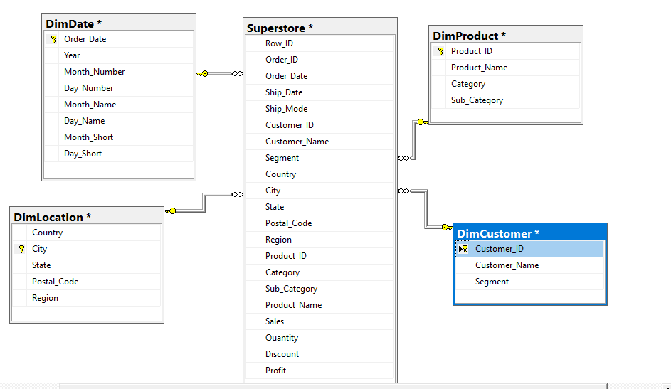
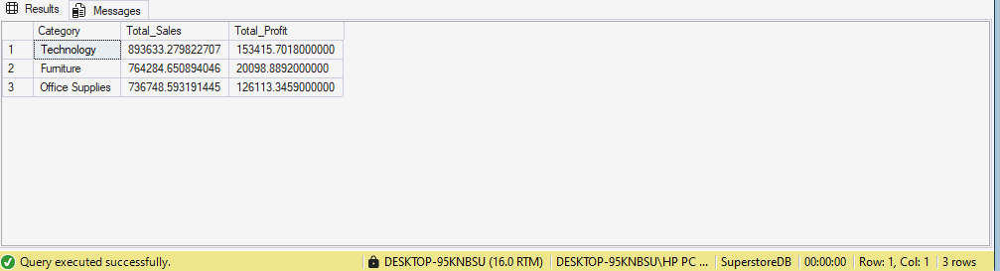
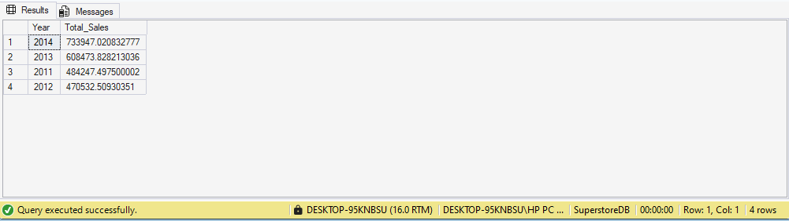
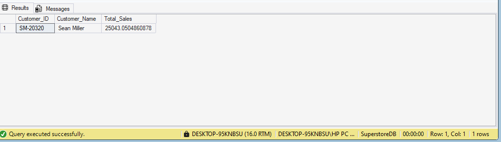

# Superstore Sales Analysis — SQL Server

A documented and reproducible SQL Server implementation of the **Superstore Sales Analysis** project by Dumoteyim Abiye-Suku. It is based on the original [Medium report](https://medium.com/@dumoaby/superstore-sales-analysis-52dbe6710270), which covers CSV import, exploratory analysis, dimensional modelling, and SQL queries for sales, profit, customers, products, and geography.

This repository preserves the report’s original screenshots and analytical scope while providing a more reproducible SQL structure. It does **not** bundle the source CSV, so the screenshots are presented as the source report’s captured results rather than as results independently rerun from data in this repository.

## Project highlights

- Builds `SuperstoreDB` in Microsoft SQL Server.
- Creates `DimDate`, `DimProduct`, `DimCustomer`, and `DimLocation` from an imported `dbo.Superstore` table.
- Reproduces the report’s 11 analytical questions, including category performance, annual sales, customer spend, and product rankings.
- Adds data-quality checks and a safe reporting view to prevent geography joins from duplicating transaction rows.
- Preserves all 17 original SQL Server screenshots from the report, with each asset linked to its original Medium CDN source.



## Repository layout

```text
.
├── assets/original-report/    # 17 original screenshots and asset-source manifest
├── data/                      # Input-data requirements; no raw data is committed
├── docs/
│   ├── analysis-guide.md      # Report walkthrough, captured outputs, and screenshot gallery
│   ├── data-dictionary.md     # Expected input fields and model definitions
│   ├── reproducibility.md     # Import and execution instructions
│   └── source-material/       # Public report capture retained as provenance
└── sql/
    ├── 00_create_database.sql
    ├── 01_build_dimensions.sql
    ├── 02_analytics.sql
    └── 03_data_quality_checks.sql
```

## Business questions

The analytical suite answers the same core questions described in the source report:

1. Which products have the strongest profit margins?
2. How do sales, profit, and profit margin compare by category?
3. Which years generated the greatest sales?
4. Which cities generated the greatest sales?
5. Which customer segment has the highest average transaction-line sales?
6. Which customer generated the highest cumulative sales?
7. Which customers lead sales in Los Angeles and in Texas?
8. Which products lead total profit or total sales, and which have the lowest total sales?

## Quick start

1. Install Microsoft SQL Server and SQL Server Management Studio or another T-SQL client.
2. Run [`sql/00_create_database.sql`](sql/00_create_database.sql).
3. Import an authorized Superstore CSV into `SuperstoreDB.dbo.Superstore` using SSMS **Import Flat File**. See [`data/README.md`](data/README.md) for the required columns.
4. Run [`sql/01_build_dimensions.sql`](sql/01_build_dimensions.sql) to validate and build the dimensional layer.
5. Run [`sql/03_data_quality_checks.sql`](sql/03_data_quality_checks.sql). Investigate unexpected rows or totals before interpreting results.
6. Run [`sql/02_analytics.sql`](sql/02_analytics.sql) to produce the analysis output.

Detailed import, validation, and interpretation notes are in [`docs/reproducibility.md`](docs/reproducibility.md).

## Model design and reliability guardrails

The source report creates the four dimensions with `SELECT DISTINCT ... INTO` and joins them back to the transaction table. That is an appropriate exploratory starting point. The executable script adds validation and creates an explicit reporting view, `dbo.vw_Superstore_Star`.

The key improvement is geographic matching. A join on `City` or `State` alone can match a transaction to several location records and inflate sales. The source screenshot of the city query shows Los Angeles at $1,055,108.04; the source report itself correctly flags city-only joins as a risk. This repository uses the complete country, city, state, postal-code, and region combination for the location dimension and includes a diagnostic query to identify repeated city names.



## Original report evidence

The source report’s screenshots document a 9,994-row `Superstore` table and its original SSMS outputs. Selected captured results include Technology as the largest category by the report’s displayed `Total_Sales`, 2014 as the leading displayed sales year, and Sean Miller as the displayed highest-spending customer. These are documented outputs, not claims reproduced against a bundled dataset.





See [`docs/analysis-guide.md`](docs/analysis-guide.md) for the full visual walkthrough, the query-to-screenshot mapping, and careful notes on interpretation.

## Data and provenance

- Original publication: [SUPERSTORE SALES ANALYSIS](https://medium.com/@dumoaby/superstore-sales-analysis-52dbe6710270)
- Source author attribution: Dumoteyim Abiye-Suku
- Original visual assets: [`assets/original-report/SOURCES.md`](assets/original-report/SOURCES.md)
- Text capture used as project provenance: [`docs/source-material/README.md`](docs/source-material/README.md)

The report content and original screenshots are attributed to the source author. No license was supplied with the source material; reuse should respect the author’s rights and any applicable dataset terms.
