# Analysis guide and original visual record

This guide documents the project presented in the original [SUPERSTORE SALES ANALYSIS Medium report](https://medium.com/@dumoaby/superstore-sales-analysis-52dbe6710270). The visual evidence below is preserved from that report. Each file is an original Medium image asset, saved under [`assets/original-report/`](../assets/original-report/) with its source URL recorded in [`SOURCES.md`](../assets/original-report/SOURCES.md).

The screenshots record the source author’s SQL Server session. They are not represented as results newly calculated by this repository, because the report’s input CSV was not provided for public redistribution. The SQL implementation in this repository follows the same analysis questions, adds validation, and avoids the join patterns that can duplicate facts.

## Data exploration

The report begins with `dbo.Superstore`, imported from a CSV file through SQL Server’s Import Flat File workflow. The visible rows include order, shipping, customer, geography, product, and measure fields. The SSMS status bar in the original screenshot reports 9,994 rows.

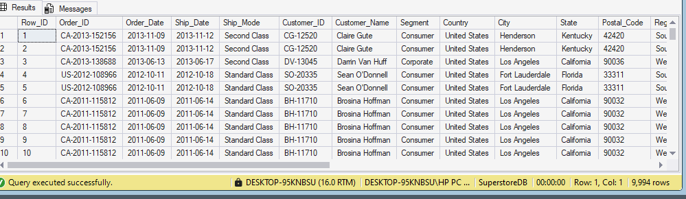

The first execution goal is to confirm field types and basic quality before making dimensions. `sql/03_data_quality_checks.sql` tests date conversion, numeric conversion, duplicate row identifiers, and source-table coverage.

## Dimensional model

The report organizes the central transaction table with four dimensions: time, product, customer, and location. This allows financial measures such as `Sales` and `Profit` to be grouped by descriptive attributes without repeatedly relying on the original wide table.

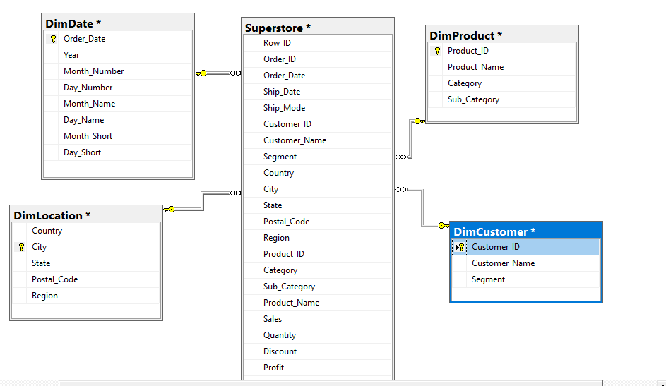

The source model links `Order_Date`, `Product_ID`, `Customer_ID`, and geographic attributes to the corresponding dimensions. The executable script keeps this analytical design but joins locations by the complete business key—country, city, state, postal code, and region. That prevents the accidental multi-match risk of using a city or state by itself.

### Time dimension

`DimDate` supplies the calendar hierarchy used for year, month, and day analysis.

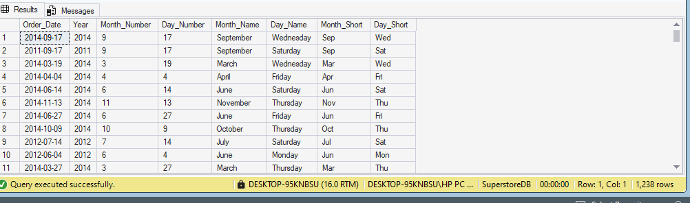

The repository creates `DateKey`, `Year`, `Month_Number`, `Day_Number`, `Month_Name`, `Day_Name`, `Month_Short`, and `Day_Short` from `Order_Date`. Invalid order dates stop the build before any analytics run.

### Product dimension

`DimProduct` organizes `Product_ID`, `Product_Name`, `Category`, and `Sub_Category`.

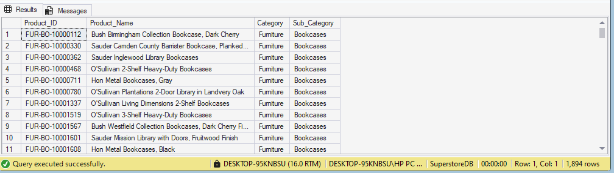

The build script verifies that a product identifier does not map to conflicting descriptive values before it creates the dimension.

### Customer dimension

`DimCustomer` supplies customer identity and segment attributes.

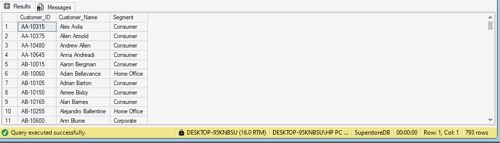

The corresponding validation checks that a customer identifier maps consistently to one name-and-segment combination.

### Location dimension

`DimLocation` stores country, city, state, postal code, and region.

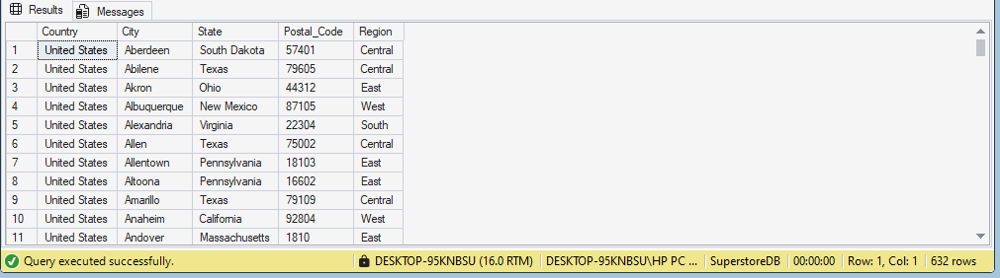

The source report appropriately notes that geography joins need validation. The repository’s model uses all five fields to locate a matching dimension record. `sql/03_data_quality_checks.sql` also lists cities with multiple location records; those rows demonstrate why a city-only join can inflate total sales.

## Captured analytical outputs

### Product profit margin

The report displays row-level profit margins for individual product records. It uses `Profit / Sales * 100`.

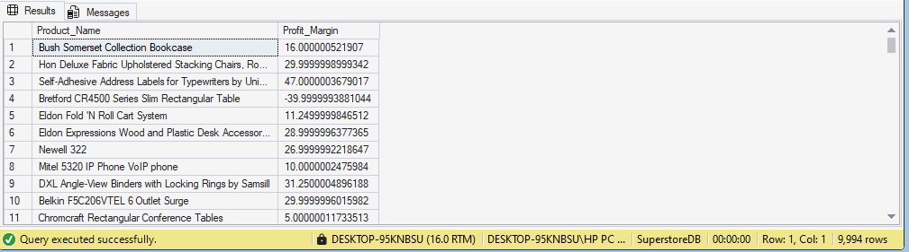

The executable query changes the aggregation order for product-level results: it divides **total profit by total sales** and uses `NULLIF` to protect against zero sales. This yields a weighted, interpretable product margin instead of an average of transaction-level percentages.

### Sales and profit by category

The original output ranks Technology first by displayed total sales, followed by Furniture and Office Supplies. The screenshot shows Technology at 893,633.28 total sales and 153,415.70 total profit; Furniture at 764,284.65 and 20,098.89; and Office Supplies at 736,748.59 and 126,113.35.

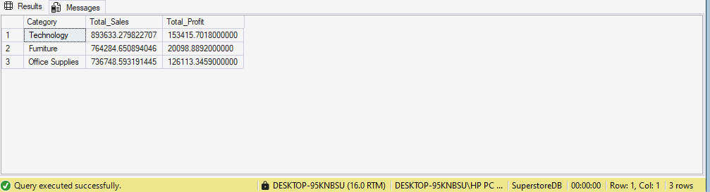

These are preserved source outputs. Before treating them as final business metrics, run the repository’s quality checks and compare raw-fact sales to reporting-view sales. The revised category query also returns a profit-margin percentage so revenue can be considered beside profitability.

### Annual sales

The original result ranks 2014 first at 710,394.70 total sales, followed by 2013 at 608,473.83, 2011 at 484,257.50, and 2012 at 470,532.51.

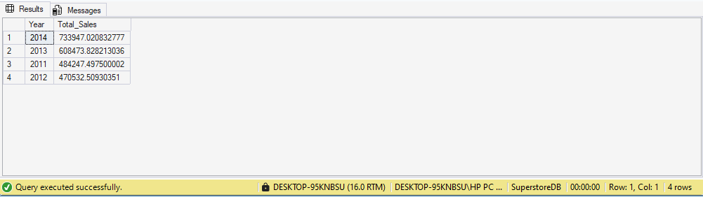

A ranking shows the leading year but not the complete trend on its own. When rerunning the analysis, examine the chronological sequence and compare the absolute values, not only the rank order.

### Sales by city

The source screenshot places Los Angeles first at 1,055,108.04 total sales, New York City second at 1,025,472.64, and Philadelphia third at 436,308.05.

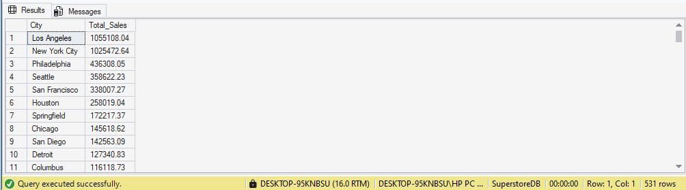

The source query joins the location dimension on `City` alone. The source report warns that this can duplicate facts. The revised query intentionally aggregates the safe reporting view by the transaction table’s city field, while the model uses a full location match. Treat the displayed city results as captured report evidence rather than validated figures until the raw dataset has been rerun.

### Average sales by customer segment

The original output shows Home Office with the largest average transaction-line sales at 240.97, followed by Corporate at 233.82 and Consumer at 223.73.

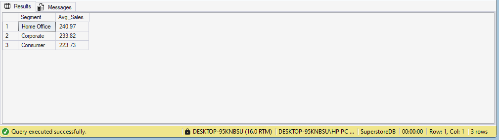

This measure is average line sales, not average customer spending or lifetime value. The analytical script labels it `Avg_Line_Sales` and returns a transaction-line count alongside it.

### Highest-spending customer

The report’s captured result identifies Sean Miller (`SM-20320`) as the highest cumulative-sales customer at 25,043.05.

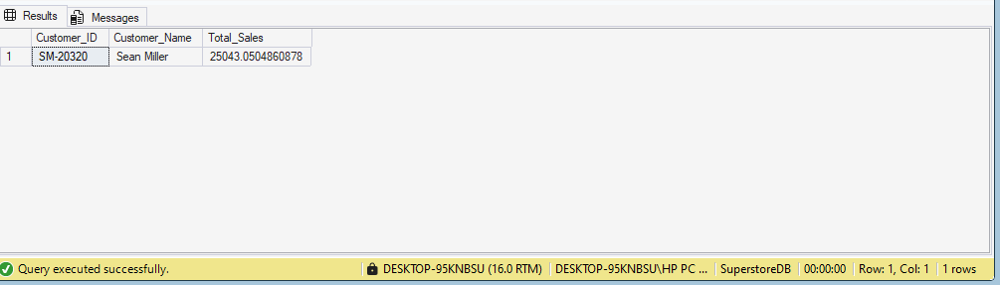

The revised query uses `TOP (1) WITH TIES` so equally ranked customers are not omitted.

### Los Angeles customer analysis

The original Los Angeles output shows Robert Akeley at 29,286.79 displayed total purchase, followed by Clay Ludtke and Karen Bern.

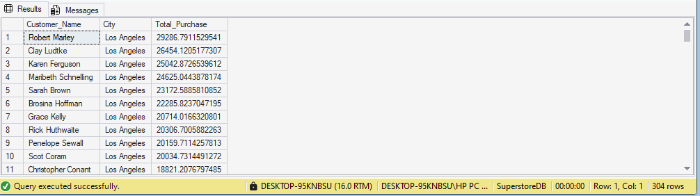

The source query filters the location dimension to Los Angeles after joining on city. The revised query filters the fact geography directly after safe dimension matching, then returns the top ten customers with ties.

### Five most profitable products

The original ranking is led by the Canon imageCLASS 2200 Advanced Copier, with displayed total profit of 25,199.93. The remaining shown products include the Fellowes PB500 Electric Punch, Hewlett Packard LaserJet 3310 Copier, Canon PC1060 Personal Laser Copier, and Logitech G19 Programmable Gaming Keyboard.

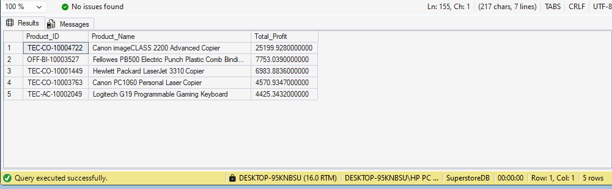

The repository preserves this question in query 08 and groups by both product identifier and product name.

### Texas customer analysis

The captured Texas output lists Becky Martin first at 62,185.88 total purchase, Sean Braxton second at 32,921.65, and Alex Avila third at 25,995.25.

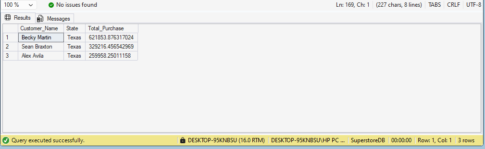

The revised implementation filters raw fact-state values within the safe reporting view rather than using a state-only location join.

### Products with the highest total sales

The original output ranks product `TEC-CO-10004722` first with displayed aggregate sales of 61,599.82. The source query labels this aggregate as `Price`, but it is cumulative sales value rather than a unit or list price.

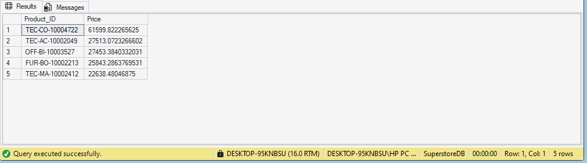

The executable query labels the result `Total_Sales` and includes the product name to make the output usable without a second lookup.

### Products with the lowest total sales

The original output lists Eureka Disposable Bags for Sanitaire Vibra Groom at 1.62 total sales, Avery 5 at 5.76, and Xerox 20 at 6.48.

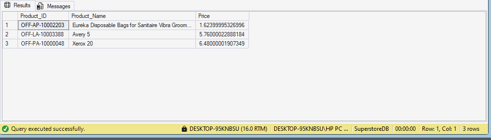

Low sales alone do not prove a product is unprofitable or should be discontinued. Combine this view with profit, margin, availability, discount, and inventory context before making an assortment decision.

## Using the executable query suite

Run [`sql/01_build_dimensions.sql`](../sql/01_build_dimensions.sql) after importing data, then run [`sql/03_data_quality_checks.sql`](../sql/03_data_quality_checks.sql). The key gate is that the raw `dbo.Superstore` row count and `dbo.vw_Superstore_Star` row count must agree. If the reporting view has more rows, stop and investigate the join logic.

When the checks are clean, execute [`sql/02_analytics.sql`](../sql/02_analytics.sql). Its eleven result sets correspond to the analytical questions above, with clearer metric labels, safe numeric conversion, and tie handling where a top-ranked result is requested.
